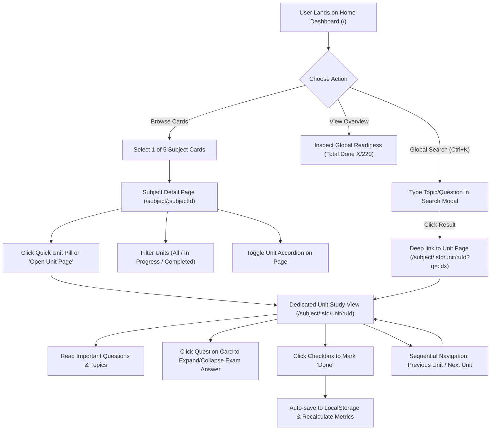
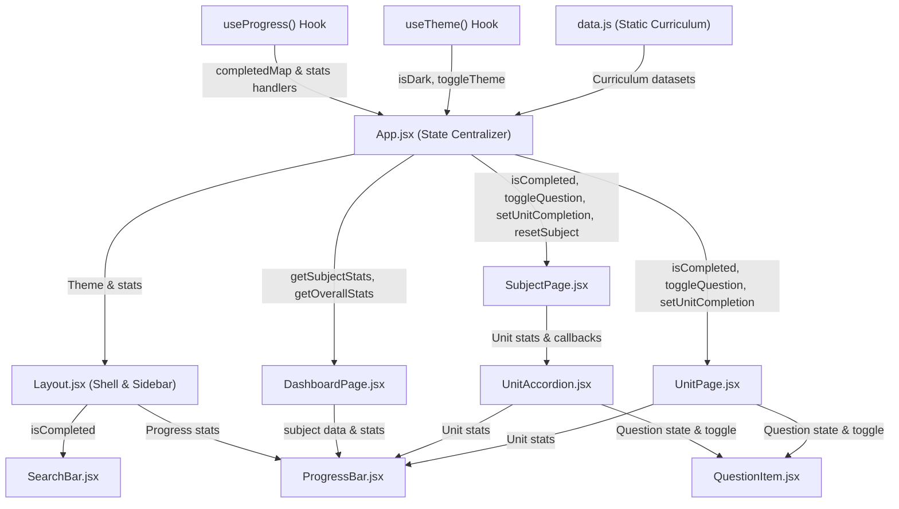
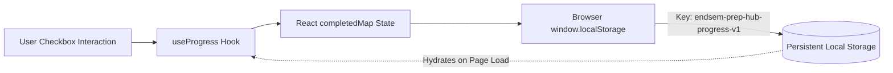

# EndSem Prep Hub — Comprehensive Project Context Report

**Document Version:** 1.0.0  
**Prepared By:** Senior Software Architect & Technical Documentation Engineer  
**Date of Audit:** November 28, 2026  
**Repository Branch:** `dheeraj-development` (Commit: `f38a132`)  
**Production Live URL:** [https://endsem-prep-hub01.vercel.app](https://endsem-prep-hub01.vercel.app)  

---

## Executive Summary

**EndSem Prep Hub** is a specialized, responsive, client-side React single-page web application (SPA) created to assist second-year engineering students under **Savitribai Phule Pune University (SPPU, 2024 Pattern)** in preparing for end-semester examinations. The application aggregates and organizes curriculum topics across **5 core technical subjects**, partitioned into **25 units**, containing **220 exam-oriented questions** with structured, point-wise model answers. 

The application is architected as a pure client-side SPA with state persistence powered by the browser's `localStorage` API, accompanied by a dark-mode first responsive user interface powered by Tailwind CSS and Lucide React icons.

---

## 1. Project Overview

### 1.1 What is this Website?
EndSem Prep Hub is an interactive exam syllabus preparation portal and revision tracking application. It bridges the gap between static PDF question banks (notably the university "Super 30" question banks) and active study tracking by providing university-style model answers alongside interactive progress indicators.

### 1.2 What Problem Does It Solve?
* **Scattered & Unstructured Study Material:** College students frequently struggle with unwieldy syllabus PDFs, unstructured lecture notes, and missing answers for past-year university questions.
* **Lack of Revision Tracking:** Students have no easy way to quantify their revision status (e.g., "Am I 40% ready or 80% ready for Operating Systems?").
* **Exam-Specific Answer Structuring:** University examinations under SPPU evaluate answers based on specific structural criteria (definitions, point-wise breakdowns, truth tables, circuit diagrams, and comparative points). The platform provides answers curated directly for examination scoring.
* **Exam-Night Fatigue:** Standard academic websites are often cluttered and bright. EndSem Prep Hub adopts a dark-first design tailored for long late-night study sessions.

### 1.3 Target Users
* **Primary Audience:** Second-Year (SE) Engineering undergraduates enrolled in SPPU (2024 Pattern) across computer engineering, information technology, artificial intelligence, and allied departments.
* **Secondary Audience:** College professors, teaching assistants, and peer-study groups seeking a standardized question bank checklist.

### 1.4 Primary Purpose
To provide an unbloated, distraction-free digital workspace where students can:
1. Browse unit-by-unit syllabus breakdowns.
2. Read concise, high-yield answers tailored for 5-mark and 10-mark SPPU exam questions.
3. Check off completed questions to maintain persistent study progress across device reloads.
4. Measure readiness through real-time mathematical progress bars at unit, subject, and total curriculum levels.
5. Search across all subjects, questions, and topics via an instant global search modal (`Ctrl+K`).

### 1.5 The Complete User Journey



1. **Discovery & Onboarding:** The student lands on the root dashboard (`/`). They immediately see their overall exam readiness percentage, total subjects (5), completed questions count, and mastered subjects count ($X/5$).
2. **Subject or Search Selection:** The student either searches for a specific concept using the `Ctrl+K` global search bar or selects a subject card (e.g., *Operating Systems*).
3. **Subject Overview:** On the Subject Page (`/subject/:subjectId`), the student evaluates unit-wise readiness, filters units by completion status ("All", "In Progress", "Completed"), and chooses whether to expand units in-place or navigate to a dedicated unit view.
4. **Focused Revision:** On the Unit Page (`/subject/:subjectId/unit/:unitId`), the student reviews the official syllabus topic list, reads questions, expands accordion panels to review model answers, and checks off questions as "Done".
5. **Progress Feedback:** Checking off a question triggers instantaneous reactivity across all parent components: strikethrough styling, "Done" badges, unit progress bar updates, subject sidebar counter updates, and global readiness updates.
6. **Persistence:** The student can close the browser or refresh at any time; all checklist state is persisted indefinitely in `localStorage`.

---

## 2. Technology Stack

The exact versions and dependency specifications identified directly from [package.json](file:///c:/Users/Admin/Desktop/end%20sem/endsem-prep-hub/package.json) and [package-lock.json](file:///c:/Users/Admin/Desktop/end%20sem/endsem-prep-hub/package-lock.json) are tabulated below:

### 2.1 Core Technologies Table

| Layer / Role | Technology | Declared Version | Resolved / Locked Version | File Reference |
| :--- | :--- | :--- | :--- | :--- |
| **Frontend Framework** | React | `^18.3.1` | `18.3.1` | [package.json](file:///c:/Users/Admin/Desktop/end%20sem/endsem-prep-hub/package.json#L14) |
| **DOM Renderer** | React DOM | `^18.3.1` | `18.3.1` | [package.json](file:///c:/Users/Admin/Desktop/end%20sem/endsem-prep-hub/package.json#L15) |
| **Language** | JavaScript (ES Modules / JSX) | ECMAScript 2022+ | Native ES Module (`"type": "module"`) | [package.json](file:///c:/Users/Admin/Desktop/end%20sem/endsem-prep-hub/package.json#L5) |
| **Client Routing** | React Router DOM | `^7.1.1` | `7.18.7` | [package.json](file:///c:/Users/Admin/Desktop/end%20sem/endsem-prep-hub/package.json#L16) |
| **Styling Framework** | Tailwind CSS | `^3.4.17` | `3.4.19` | [tailwind.config.js](file:///c:/Users/Admin/Desktop/end%20sem/endsem-prep-hub/tailwind.config.js) |
| **CSS Processing** | PostCSS | `^8.4.49` | `8.5.33` | [postcss.config.js](file:///c:/Users/Admin/Desktop/end%20sem/endsem-prep-hub/postcss.config.js) |
| **Vendor Prefixing** | Autoprefixer | `^10.4.20` | `10.7.0` | [package.json](file:///c:/Users/Admin/Desktop/end%20sem/endsem-prep-hub/package.json#L20) |
| **Icon Library** | Lucide React | `^0.468.0` | `0.468.0` | [package.json](file:///c:/Users/Admin/Desktop/end%20sem/endsem-prep-hub/package.json#L13) |
| **Web Analytics** | Vercel Analytics | `^2.0.1` | `2.0.1` | [package.json](file:///c:/Users/Admin/Desktop/end%20sem/endsem-prep-hub/package.json#L12) |
| **Build Tool / Dev Server** | Vite | *Transitive peer dependency* | `7.3.8` | [vite.config.js](file:///c:/Users/Admin/Desktop/end%20sem/endsem-prep-hub/vite.config.js) |
| **Vite React Plugin** | `@vitejs/plugin-react` | `^4.3.4` | `4.7.0` | [package.json](file:///c:/Users/Admin/Desktop/end%20sem/endsem-prep-hub/package.json#L19) |
| **Client Storage** | Web Storage API (`localStorage`) | Native Browser Standard | N/A | [useProgress.js](file:///c:/Users/Admin/Desktop/end%20sem/endsem-prep-hub/src/hooks/useProgress.js#L3) |
| **Hosting Platform** | Vercel Static Hosting | Serverless Static Delivery | N/A | [vercel.json](file:///c:/Users/Admin/Desktop/end%20sem/endsem-prep-hub/vercel.json) |
| **Typography Source** | Google Fonts (`Inter`) | CDN Preconnect | Weights: 400, 500, 600, 700, 800 | [index.html](file:///c:/Users/Admin/Desktop/end%20sem/endsem-prep-hub/index.html#L10) |

> [!WARNING]
> **Build Tool Declaration Notice:** `vite` is invoked directly in `npm run dev`, `npm run build`, and `npm run preview` scripts, but is omitted from direct `devDependencies` in [package.json](file:///c:/Users/Admin/Desktop/end%20sem/endsem-prep-hub/package.json#L18-L23). It currently resolves solely as a peer dependency of `@vitejs/plugin-react`.

---

## 3. Complete Website Structure

### 3.1 Directory Hierarchy

```text
c:\Users\Admin\Desktop\end sem\endsem-prep-hub\
├── .git/                                 # Git version control metadata
├── .gitignore                            # Standard git exclusions (node_modules, dist, etc.)
├── index.html                            # HTML5 root template (Inter font, dark class)
├── package.json                          # Project manifest, scripts, and direct dependencies
├── package-lock.json                     # Deterministic dependency lockfile (v3)
├── postcss.config.js                     # PostCSS config registering Tailwind and Autoprefixer
├── README.md                             # User-facing markdown documentation and live link
├── tailwind.config.js                    # Tailwind configuration (dark mode, colors, fonts)
├── vercel.json                           # Vercel deployment build & output specification
├── vite.config.js                        # Vite bundler configuration with React plugin
└── src/                                  # Application source root
    ├── App.jsx                           # Root component: router, theme & progress wiring
    ├── main.jsx                          # React 18 DOM mount point with StrictMode
    ├── index.css                         # Global CSS, Tailwind directives, custom scrollbars
    ├── data.js                           # Subject aggregator combining all 5 subject datasets
    ├── components/                       # Shared reusable UI components
    │   ├── Layout.jsx                    # App shell: header, desktop sidebar, mobile drawer
    │   ├── ProgressBar.jsx               # Dynamic progress bar component with percentage
    │   ├── QuestionItem.jsx              # Expandable question card with checklist toggle
    │   ├── SearchBar.jsx                 # Global search input with Ctrl+K modal dropdown
    │   ├── SubjectCard.jsx               # Dashboard subject presentation card
    │   └── UnitAccordion.jsx             # Collapsible unit container with batch actions
    ├── hooks/                            # Custom state management hooks
    │   ├── useProgress.js                # LocalStorage checklist state & stats calculation
    │   └── useTheme.js                   # LocalStorage dark/light theme switching
    ├── pages/                            # Top-level route views
    │   ├── DashboardPage.jsx             # Landing view: readiness stats & subject cards
    │   ├── SubjectPage.jsx               # Subject overview, unit filters & accordions
    │   └── UnitPage.jsx                  # Dedicated unit study view with sequential navigation
    ├── subjectsData/                     # Static curriculum datasets (220 questions)
    │   ├── ai.js                         # Foundation of AI (5 units, 30 questions)
    │   ├── deld.js                       # DELD (5 units, 50 questions)
    │   ├── df.js                         # Digital Finance (5 units, 50 questions)
    │   ├── os.js                         # Operating Systems (5 units, 40 questions)
    │   └── uhv.js                        # Universal Human Values (5 units, 50 questions)
    └── utils/                            # Utility helpers
        └── subjectIcons.js               # Lucide icon mapping and theme accent tokens
```

### 3.2 Pages, Routes, and Layouts

| Route Path | Associated Page Component | Layout Wrapper | Purpose & Description |
| :--- | :--- | :--- | :--- |
| `/` | [DashboardPage.jsx](file:///c:/Users/Admin/Desktop/end%20sem/endsem-prep-hub/src/pages/DashboardPage.jsx) | [Layout.jsx](file:///c:/Users/Admin/Desktop/end%20sem/endsem-prep-hub/src/components/Layout.jsx) | **Home Dashboard:** Hero banner, 3-metric statistics counter, syllabus-wide readiness progress bar, and 5 responsive subject cards. |
| `/subject/:subjectId` | [SubjectPage.jsx](file:///c:/Users/Admin/Desktop/end%20sem/endsem-prep-hub/src/pages/SubjectPage.jsx) | [Layout.jsx](file:///c:/Users/Admin/Desktop/end%20sem/endsem-prep-hub/src/components/Layout.jsx) | **Subject Overview:** Subject-level header, dynamic progress bar, "Reset Subject" action, quick unit navigation pills, status filter tabs ("All", "In Progress", "Completed"), and 5 collapsible unit accordions. |
| `/subject/:subjectId/unit/:unitId` | [UnitPage.jsx](file:///c:/Users/Admin/Desktop/end%20sem/endsem-prep-hub/src/pages/UnitPage.jsx) | [Layout.jsx](file:///c:/Users/Admin/Desktop/end%20sem/endsem-prep-hub/src/components/Layout.jsx) | **Dedicated Unit Study View:** Full unit syllabus topics, unit progress bar, "Mark All Done" / "Reset Unit" toggle, all question cards, search target scroll focus (`?q=:idx`), and Previous/Next unit footer buttons. |
| `*` (Catch-All) | `<Navigate to="/" replace />` | [Layout.jsx](file:///c:/Users/Admin/Desktop/end%20sem/endsem-prep-hub/src/components/Layout.jsx) | Redirects any unmapped or invalid route directly back to the Home Dashboard. |

### 3.3 Component Breakdown and Responsibilities

#### 1. [Layout.jsx](file:///c:/Users/Admin/Desktop/end%20sem/endsem-prep-hub/src/components/Layout.jsx)
* **Role:** Global application shell providing fixed navigation headers, a persistent desktop sidebar, and an overlay drawer for mobile devices.
* **Key Elements:**
  * Top navigation header (`sticky top-0 z-40`) featuring branding, logo, mobile hamburger trigger, embedded `SearchBar`, and dark/light theme switch button.
  * Desktop sidebar (`sticky top-16 hidden lg:block w-64`) listing navigation links, all 5 subjects with live completion counters ($X/Y$), and an overall readiness widget.
  * Mobile slide-over drawer (`fixed inset-0 z-50 lg:hidden`) with backdrop blur dismissing on backdrop tap or item selection.

#### 2. [ProgressBar.jsx](file:///c:/Users/Admin/Desktop/end%20sem/endsem-prep-hub/src/components/ProgressBar.jsx)
* **Role:** Universal progress indicator component supporting customizable sizing (`sm`, `md`, `lg`), custom gradient styles, and text visibility toggles.
* **Mathematical Function:** Computes percentage as $\text{round}\left(\frac{\text{completed}}{\text{total}} \times 100\right)$ (handling divide-by-zero safely).
* **Accessibility:** Implements WAI-ARIA attributes (`role="progressbar"`, `aria-valuenow`, `aria-valuemin="0"`, `aria-valuemax="100"`).

#### 3. [QuestionItem.jsx](file:///c:/Users/Admin/Desktop/end%20sem/endsem-prep-hub/src/components/QuestionItem.jsx)
* **Role:** Core study interaction card displaying question index badge, question title, "Done" indicator, interactive checkbox, and smoothly collapsible model answer.
* **Event Handling & Isolation:** Checkbox clicks call `e.stopPropagation()`, ensuring that marking a question as completed does not inadvertently toggle answer expansion.
* **Text Selection Guard:** Detects `window.getSelection()` during card clicks so that students selecting text to copy notes do not trigger accordion collapse.
* **Animation:** Uses CSS Grid transitions (`grid-rows-[1fr]` to `grid-rows-[0fr]`) for fluid height animations.

#### 4. [SearchBar.jsx](file:///c:/Users/Admin/Desktop/end%20sem/endsem-prep-hub/src/components/SearchBar.jsx)
* **Role:** Global omni-search input capable of querying questions, answers, and unit syllabus topics across all 5 subjects simultaneously.
* **Keyboard Navigation:** Binds global window listeners for `Ctrl+K` and `Cmd+K` to focus the search input, and `Escape` to close the dropdown.
* **Deep Linking:** Selecting a search result navigates directly to `/subject/:subjectId/unit/:unitId?q=:questionIndex`, where `UnitPage` automatically scrolls the target question into view and expands its answer.

#### 5. [SubjectCard.jsx](file:///c:/Users/Admin/Desktop/end%20sem/endsem-prep-hub/src/components/SubjectCard.jsx)
* **Role:** Dashboard grid card presenting subject identity, icon, description, unit/question metrics, customized accent glow, and subject-level `ProgressBar`.

#### 6. [UnitAccordion.jsx](file:///c:/Users/Admin/Desktop/end%20sem/endsem-prep-hub/src/components/UnitAccordion.jsx)
* **Role:** Collapsible container used on `SubjectPage` to display unit progress, syllabus topics preview, batch completion actions ("Mark All Done" / "Reset Unit"), and the nested list of `QuestionItem` components.

### 3.4 Component Communication & Data Flow Architecture

The application adopts a **unidirectional top-down data flow** centered in [App.jsx](file:///c:/Users/Admin/Desktop/end%20sem/endsem-prep-hub/src/App.jsx):



* **State Store:** `useProgress` maintains `completedMap` as an in-memory dictionary synchronized with `localStorage`.
* **Prop Drilling vs Context:** The codebase does not use React Context. Handlers (`toggleQuestion`, `setUnitCompletion`, `resetSubjectProgress`, `getUnitStats`, etc.) are passed down explicitly as props through page routes.
* **Inter-Page Communication:** Page switches and deep links communicate state via URL parameters (`useParams` for `subjectId` and `unitId`, `useSearchParams` for `?q=`).

---

## 4. Features and Functionality

### 4.1 Detailed Feature Inventory

| Feature | Implementation Status | Functional Description & Code Location |
| :--- | :--- | :--- |
| **Comprehensive Curriculum** | **Fully Implemented** | Contains all 5 SPPU subjects, 25 units, and 220 questions with exam answers. Defined in [src/subjectsData/](file:///c:/Users/Admin/Desktop/end%20sem/endsem-prep-hub/src/subjectsData/). |
| **Interactive Checklists** | **Fully Implemented** | Clicking a checkbox updates the question key (`${subjectId}:${unitId}:${questionIndex}`) in state and `localStorage`. Visual strikethrough and "Done" badge applied. Handled in [QuestionItem.jsx](file:///c:/Users/Admin/Desktop/end%20sem/endsem-prep-hub/src/components/QuestionItem.jsx#L77-L91). |
| **Expandable Model Answers** | **Fully Implemented** | Clicking anywhere on a question card expands the exam-oriented answer using CSS grid transitions. Selection detection prevents collapse while copying text. Located in [QuestionItem.jsx](file:///c:/Users/Admin/Desktop/end%20sem/endsem-prep-hub/src/components/QuestionItem.jsx#L30-L38). |
| **Real-time Progress Calculation** | **Fully Implemented** | Computes completed counts and completion percentages on the fly for units, subjects, and the entire syllabus. Located in [useProgress.js](file:///c:/Users/Admin/Desktop/end%20sem/endsem-prep-hub/src/hooks/useProgress.js#L87-L130). |
| **Bulk Unit Completion** | **Fully Implemented** | "Mark All Done" marks all questions in a unit as completed in one click; when fully completed, button flips to "Reset Unit". Handled in [useProgress.js](file:///c:/Users/Admin/Desktop/end%20sem/endsem-prep-hub/src/hooks/useProgress.js#L59-L72). |
| **Subject Progress Reset** | **Fully Implemented** | "Reset Subject Progress" button purges all completed question keys matching `${subjectId}:`. Handled in [useProgress.js](file:///c:/Users/Admin/Desktop/end%20sem/endsem-prep-hub/src/hooks/useProgress.js#L74-L85). |
| **Global Search with Shortcuts** | **Fully Implemented** | Searches questions, answers, and unit topics in real-time. Opens via `Ctrl+K` / `Cmd+K`, closes via `Escape` or outside click. Deep-links to target question with auto-scroll. Located in [SearchBar.jsx](file:///c:/Users/Admin/Desktop/end%20sem/endsem-prep-hub/src/components/SearchBar.jsx). |
| **Dark / Light Theme Toggle** | **Fully Implemented** | Defaults to dark theme (`slate-950`). Toggled via header button. Persisted in `localStorage` under `endsem-prep-hub-theme`. Handled in [useTheme.js](file:///c:/Users/Admin/Desktop/end%20sem/endsem-prep-hub/src/hooks/useTheme.js). |
| **Responsive Shell & Drawer** | **Fully Implemented** | Persistent sidebar on desktop (`lg:block`), slide-over drawer on mobile devices with backdrop blur. Handled in [Layout.jsx](file:///c:/Users/Admin/Desktop/end%20sem/endsem-prep-hub/src/components/Layout.jsx). |
| **Unit Status Filtering** | **Fully Implemented** | Filter buttons on `SubjectPage` to view "All Units", "In Progress", or "Completed". Handled in [SubjectPage.jsx](file:///c:/Users/Admin/Desktop/end%20sem/endsem-prep-hub/src/pages/SubjectPage.jsx#L161-L203). |
| **Sequential Unit Navigation** | **Fully Implemented** | "Previous Unit" and "Next Unit" links at the bottom of `UnitPage` enabling linear syllabus walkthroughs. Handled in [UnitPage.jsx](file:///c:/Users/Admin/Desktop/end%20sem/endsem-prep-hub/src/pages/UnitPage.jsx#L191-L213). |
| **Web Telemetry** | **Fully Implemented** | Vercel Web Analytics tracker integrated at application root. Located in [App.jsx](file:///c:/Users/Admin/Desktop/end%20sem/endsem-prep-hub/src/App.jsx#L74). |
| **Question Bookmarking / Starring**| **Not Implemented** | No ability for students to flag questions for last-minute revision. |
| **Data Export / Backup / Sync** | **Not Implemented** | No option to export progress to JSON or sync across devices. |
| **Reset Confirmation Dialogs** | **Not Implemented** | Subject and Unit resets occur immediately without a confirmation prompt. |
| **Quiz / Flashcard Mode** | **Not Implemented** | No interactive self-test or active recall testing mode. |

### 4.2 Subject & Question Breakdown

```
Total Curriculum: 5 Subjects | 25 Units | 220 Questions
├── Foundation of Artificial Intelligence (ai): 5 Units | 30 Questions (8+5+5+7+5)
├── Digital Electronics & Logic Design (deld): 5 Units | 50 Questions (10+10+10+10+10)
├── Operating Systems (os): 5 Units | 40 Questions (8+8+8+8+8)
├── Universal Human Values (uhv): 5 Units | 50 Questions (10+10+10+10+10)
└── Digital Finance (df): 5 Units | 50 Questions (10+10+10+10+10)
```

---

## 5. UI/UX Analysis

### 5.1 Design Language and Aesthetic
The interface applies an **academic dashboard design system** with dark-mode prioritization. The design utilizes subtle elevation, frosted glass headers (`backdrop-blur-md`), ambient color glows corresponding to specific subject identities, and high-contrast typography.

### 5.2 Color Tokens & Subject Accent Palette
Subject visual identities are mapped via [subjectIcons.js](file:///c:/Users/Admin/Desktop/end%20sem/endsem-prep-hub/src/utils/subjectIcons.js):

| Subject | Accent Name | Primary Gradient / Bar | Badge & Border Style | Lucide Icon |
| :--- | :--- | :--- | :--- | :--- |
| **AI** (`ai`) | `indigo` | `from-indigo-500 to-emerald-400` | `bg-indigo-500/15 text-indigo-400 border-indigo-500/30` | `BrainCircuit` |
| **DELD** (`deld`) | `emerald` | `from-emerald-500 to-teal-400` | `bg-emerald-500/15 text-emerald-400 border-emerald-500/30` | `Cpu` |
| **OS** (`os`) | `cyan` | `from-cyan-500 to-emerald-400` | `bg-cyan-500/15 text-cyan-400 border-cyan-500/30` | `Settings` |
| **UHV** (`uhv`) | `rose` | `from-rose-500 to-amber-400` | `bg-rose-500/15 text-rose-400 border-rose-500/30` | `HeartHandshake` |
| **DF** (`df`) | `amber` | `from-amber-500 to-emerald-400` | `bg-amber-500/15 text-amber-400 border-amber-500/30` | `Landmark` |

* **Backgrounds:** Dark mode uses `slate-950` (`#070b14`) as the page canvas, with elevated surface cards rendered in `slate-900` (`#0f172a`) and `slate-900/70`. Light mode uses `slate-50` and pure `white`.
* **Status Colors:** Emerald (`#10b981`) indicates completed states; Rose (`#f43f5e`) indicates reset actions.

### 5.3 Typography and Layout
* **Font Family:** `Inter`, loaded via Google Fonts CDN in [index.html](file:///c:/Users/Admin/Desktop/end%20sem/endsem-prep-hub/index.html#L10), with fallback to standard system sans-serif fonts.
* **Tabular Figures:** Completion counters use Tailwind's `tabular-nums` class to eliminate horizontal layout jitter when numbers increment or decrement.
* **Breakpoints:**
  * **Desktop ($\ge 1024\text{px}$):** Persistent 256px (`w-64`) left sidebar, centered 1280px (`max-w-7xl`) main content area, 3-column subject card grid.
  * **Tablet ($640\text{px} - 1023\text{px}$):** Sidebar collapses; navigation available via top hamburger menu; 2-column subject card grid.
  * **Mobile ($< 640\text{px}$):** Single-column stacked layout; slide-over drawer; full-width search input; compact cards.

### 5.4 Identified UI/UX Weaknesses & Opportunities
1. **Destructive Action Sensitivity:** Clicking "Reset Subject Progress" or "Reset Unit" instantly wipes completed states with no confirmation modal or undo toast.
2. **Touch Target Proximity:** On smaller mobile touchscreens, the 24x24px checkbox button is located directly adjacent to the card body. While `stopPropagation` is implemented, users with larger fingers may accidentally toggle card expansion when aiming for the checkbox.
3. **Search Dropdown Viewport Constraints:** The search modal renders as an absolute dropdown beneath the header input (`max-h-[70vh]`). On mobile viewports with an open virtual keyboard, the dropdown can overflow or become difficult to scroll.
4. **Print / Offline Export:** The application lacks print-specific CSS (`@media print`) for students who wish to print unit question sheets or export to PDF.

---

## 6. Backend and Data Flow

### 6.1 Data Persistence Model
EndSem Prep Hub operates as a **serverless, client-only single-page application**. It does not maintain a traditional backend server, database, or microservice layer.



* **Storage Key:** `endsem-prep-hub-progress-v1`
* **Theme Storage Key:** `endsem-prep-hub-theme`
* **Schema of `completedMap`:**
  ```json
  {
    "ai:u1:0": true,
    "ai:u1:1": true,
    "os:u2:4": true
  }
  ```
  Keys are structured deterministically via `makeQuestionKey(subjectId, unitId, questionIndex)` as `${subjectId}:${unitId}:${questionIndex}`. When a question is unmarked, the key is removed from the dictionary using JavaScript's `delete` operator to conserve storage footprint.

### 6.2 Data Schema (Curriculum Objects)
All curriculum content is statically bundled as ES modules in `src/subjectsData/`. The TypeScript-equivalent structure of the datasets is:

```typescript
interface Question {
  id: string;        // e.g., "ai-u1-q1"
  question: string;  // The examination question prompt
  answer: string;    // Formatted, point-wise model answer
}

interface Unit {
  id: string;        // e.g., "u1", "u2", "u3", "u4", "u5"
  name: string;      // e.g., "Unit 1: Introduction to AI"
  topics?: string;   // Summary string of official SPPU syllabus topics
  questions: Question[];
}

interface Subject {
  id: string;        // "ai" | "deld" | "os" | "uhv" | "df"
  name: string;      // Full university title
  shortName: string; // Abbreviated identifier (e.g., "AI", "DELD")
  icon: string;      // Matches Lucide icon identifier in subjectIcons.js
  accent: 'indigo' | 'emerald' | 'cyan' | 'rose' | 'amber';
  description: string;
  units: Unit[];     // Array of exactly 5 unit objects
}
```

### 6.3 External Integrations
1. **Vercel Web Analytics:** Initialized in [App.jsx](file:///c:/Users/Admin/Desktop/end%20sem/endsem-prep-hub/src/App.jsx#L74) via `<Analytics />` from `@vercel/analytics/react`. Tracks page views and basic performance metrics when deployed to Vercel.
2. **Google Fonts CDN:** Preconnected and linked in [index.html](file:///c:/Users/Admin/Desktop/end%20sem/endsem-prep-hub/index.html#L7-L12) to serve `Inter`.

---

## 7. Current Project Status

### 7.1 Completion Matrix

| Area / Subsystem | Status | Verification & Findings |
| :--- | :--- | :--- |
| **Core Curriculum Data** | **100% Completed** | All 5 subjects, 25 units, and 220 questions with full answers are present and verified. |
| **Client Routing** | **100% Completed** | Home (`/`), Subject (`/subject/:subjectId`), and Unit (`/subject/:subjectId/unit/:unitId`) routes function with wildcard fallback. |
| **UI Component System** | **100% Completed** | Header, sidebar, drawer, progress bars, cards, accordions, and questions are implemented. |
| **State & Persistence** | **100% Completed** | LocalStorage read/write logic, question toggles, batch unit toggles, and subject resets are operational. |
| **Theme System** | **100% Completed** | Dark/light class switching is functional and persists across reloads. |
| **Local Dependencies** | **Partially Completed** | The repository currently contains an incomplete `node_modules` folder (only `lucide-react` is present locally). Running `npm run build` fails because `vite` is not installed locally. |
| **Package Declarations** | **Needs Attention** | `vite` is omitted from `devDependencies` in [package.json](file:///c:/Users/Admin/Desktop/end%20sem/endsem-prep-hub/package.json). |
| **Vercel SPA Rewrites** | **Needs Attention** | [vercel.json](file:///c:/Users/Admin/Desktop/end%20sem/endsem-prep-hub/vercel.json) specifies `buildCommand` and `outputDirectory`, but omits rewrite rules for client-side routing. Direct URL refreshes on subroutes will produce 404s on Vercel. |

### 7.2 Code Quality & Bug Audit

#### Bug 1: Duplicate Import Declaration in [App.jsx](file:///c:/Users/Admin/Desktop/end%20sem/endsem-prep-hub/src/App.jsx)
* **Location:** Lines 1 and 4 of [src/App.jsx](file:///c:/Users/Admin/Desktop/end%20sem/endsem-prep-hub/src/App.jsx#L1-L4):
  ```javascript
  import { Analytics } from '@vercel/analytics/react'; // Line 1
  import React from 'react';
  import { BrowserRouter, Routes, Route, Navigate } from 'react-router-dom';
  import { Analytics } from '@vercel/analytics/react'; // Line 4 (DUPLICATE)
  ```
* **Impact:** In strict ES2015+ module execution and standard bundlers, importing the same identifier twice within the same lexical scope triggers a `SyntaxError: Identifier 'Analytics' has already been declared` or compiler warnings during bundling.

#### Bug 2: Missing SPA Fallback Rewrites in [vercel.json](file:///c:/Users/Admin/Desktop/end%20sem/endsem-prep-hub/vercel.json)
* **Location:** [vercel.json](file:///c:/Users/Admin/Desktop/end%20sem/endsem-prep-hub/vercel.json#L1-L4):
  ```json
  {
    "buildCommand": "npm run build",
    "outputDirectory": "dist"
  }
  ```
* **Impact:** Because React Router DOM handles client-side routing dynamically, requesting a URL like `https://endsem-prep-hub01.vercel.app/subject/ai` directly or refreshing the browser causes Vercel's edge server to look for a physical file at `/subject/ai/index.html`, which does not exist, yielding a **404 Not Found**.

---

## 8. GitHub and Collaboration

### 8.1 Repository Metadata
* **Remote Origin:** `https://github.com/Dimpal-Sharma231/endsem-prep-hub.git`
* **Active Working Branch:** `dheeraj-development` (tracking `origin/dheeraj-development`)
* **Default Branch:** `main` (tracking `origin/main`)
* **Synchronization Status:** `dheeraj-development` is currently synchronized and identical with `main` at commit `f38a132`.
* **Working Tree:** Clean (no uncommitted or modified files).

### 8.2 Commit Log History
```text
* f38a132 (HEAD -> dheeraj-development, origin/main, origin/dheeraj-development, main) feat: add root App component with routing and analytics
* 6661754 Add Vercel Web Analytics
* bb00732 Updated README with correct live link
* be2fe91 Added live website link to README
* 306db58 Initial commit: EndSem Prep Hub
```

### 8.3 Recommended Collaboration Guidelines
1. **Branch Protection:** Protect the `main` branch against direct pushes. Require pull requests with peer review.
2. **Feature Branching:** Contributors should branch off `main` using structured naming conventions:
   * `feat/<feature-name>` (e.g., `feat/question-bookmarking`)
   * `fix/<bug-name>` (e.g., `fix/duplicate-analytics-import`)
3. **Merge Conflict Hotspots:**
   * [src/App.jsx](file:///c:/Users/Admin/Desktop/end%20sem/endsem-prep-hub/src/App.jsx): Central nexus for route declarations, imports, and top-level hooks.
   * [src/data.js](file:///c:/Users/Admin/Desktop/end%20sem/endsem-prep-hub/src/data.js): Additions of new subjects or data structures.
   * `package.json` & `package-lock.json`: Dependency installations and lockfile synchronizations.

---

## 9. Improvement Opportunities

The following recommendations are organized by architectural priority to guide future development iterations:

### Priority Matrix

```mermaid
quadrantChart
    title Improvement Priority Matrix
    x-axis Low Effort --> High Effort
    y-axis Low Impact --> High Impact
    quadrant-1 High Priority / Strategic
    quadrant-2 Quick Wins (Critical)
    quadrant-3 Low Priority
    quadrant-4 Medium Priority / Maintenance
    "Fix App.jsx Duplicate Import": [0.1, 0.95]
    "Add SPA Rewrites to vercel.json": [0.15, 0.92]
    "Declare vite in package.json": [0.1, 0.85]
    "Reset Confirmation Dialogs": [0.25, 0.75]
    "Export / Import Progress JSON": [0.35, 0.70]
    "Question Bookmarks / Stars": [0.45, 0.80]
    "PWA Offline Caching": [0.65, 0.65]
    "Interactive Quiz Mode": [0.85, 0.82]
    "Cloud Sync (Firebase/Supabase)": [0.90, 0.60]
```

### 9.1 Critical Priority (Immediate Fixes)
1. **Remove Duplicate Import in [App.jsx](file:///c:/Users/Admin/Desktop/end%20sem/endsem-prep-hub/src/App.jsx):**
   Delete line 1 or line 4 to eliminate the redundant `import { Analytics } from '@vercel/analytics/react'`.
2. **Add Client-Side Route Rewrites in [vercel.json](file:///c:/Users/Admin/Desktop/end%20sem/endsem-prep-hub/vercel.json):**
   Update `vercel.json` to include `"rewrites": [{ "source": "/(.*)", "destination": "/" }]` so deep URLs refresh correctly without 404 errors.
3. **Explicitly Declare `vite` in [package.json](file:///c:/Users/Admin/Desktop/end%20sem/endsem-prep-hub/package.json):**
   Add `"vite": "^5.4.0"` (or matching lockfile version) to `devDependencies` to ensure standard `npm install && npm run build` pipelines succeed in clean CI/CD environments.

### 9.2 High Priority
1. **Confirmation Modals for Destructive Reset Operations:**
   Introduce a modal or browser confirmation dialog prior to executing `resetSubjectProgress` or batch unchecking units to prevent accidental loss of study progress.
2. **Progress Backup & Restore (JSON Export/Import):**
   Allow students to export their `localStorage` checklist state to a `.json` file and restore it on another device or browser.
3. **Optimized Mobile Tap Zones:**
   Increase the interactive hit target of checkboxes in [QuestionItem.jsx](file:///c:/Users/Admin/Desktop/end%20sem/endsem-prep-hub/src/components/QuestionItem.jsx) to a minimum of $44 \times 44\text{px}$ to comply with mobile accessibility guidelines.

### 9.3 Medium Priority
1. **Bookmarking & Starred Questions:**
   Add a "Star" icon button to `QuestionItem` and a filter tab on `SubjectPage` to review only starred/flagged questions before exams.
2. **Progressive Web App (PWA) Offline Support:**
   Incorporate `vite-plugin-pwa` to register a service worker and web manifest, allowing students to access syllabus topics and answers offline during commutes.
3. **Fuzzy Search & Answer Highlighting:**
   Upgrade `SearchBar` from basic substring matching (`includes`) to fuzzy searching (e.g., using Fuse.js) and highlight matching text within model answers.

### 9.4 Future Enhancements
1. **Interactive Self-Assessment / Flashcard Mode:**
   A dedicated revision screen that shows questions with hidden answers and prompts the student to rate their recall confidence before revealing the answer.
2. **Cloud Synchronization:**
   Optional user authentication (e.g., via Supabase or Firebase Auth) allowing progress to synchronize across mobile and desktop devices.
3. **Printable Revision Sheets:**
   A print stylesheet (`@media print`) that formats selected units cleanly onto standard A4 paper for students who prefer physical revision.

---

## 10. Final Technical Summary

### 10.1 Quick Developer Reference Sheet

| Item | Details |
| :--- | :--- |
| **Project Name** | EndSem Prep Hub |
| **Primary Framework** | React 18.3.1 (Vite + Tailwind CSS 3.4.17) |
| **Curriculum Scope** | SPPU Second Year (2024 Pattern) — 5 Subjects, 25 Units, 220 Questions |
| **State Persistence** | Client `localStorage` (`endsem-prep-hub-progress-v1`) |
| **Primary Entry Points** | [src/main.jsx](file:///c:/Users/Admin/Desktop/end%20sem/endsem-prep-hub/src/main.jsx) (Mount), [src/App.jsx](file:///c:/Users/Admin/Desktop/end%20sem/endsem-prep-hub/src/App.jsx) (Router & State), [src/data.js](file:///c:/Users/Admin/Desktop/end%20sem/endsem-prep-hub/src/data.js) (Curriculum) |
| **Current Git Branch** | `dheeraj-development` (identical to `main` at `f38a132`) |
| **Deployment URL** | `https://endsem-prep-hub01.vercel.app` |

### 10.2 Recommended Next Development Steps
When development resumes on the codebase, the following sequence of tasks is recommended:
1. Run `npm install` in the workspace to restore missing node modules (`vite`, `react`, `react-router-dom`, etc.).
2. Remove the duplicate `Analytics` import in [src/App.jsx](file:///c:/Users/Admin/Desktop/end%20sem/endsem-prep-hub/src/App.jsx#L1-L4).
3. Add `"vite": "^5.4.0"` to `devDependencies` in [package.json](file:///c:/Users/Admin/Desktop/end%20sem/endsem-prep-hub/package.json).
4. Add the SPA rewrite rule to [vercel.json](file:///c:/Users/Admin/Desktop/end%20sem/endsem-prep-hub/vercel.json).
5. Verify the production build via `npm run build && npm run preview`.
6. Commit changes to `dheeraj-development` and submit a Pull Request to `main`.
